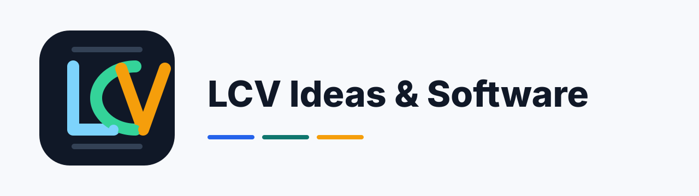

<div align="center">
  
</div>

<h1 align="center">
  
</h1>

<h3 align="center">LCV Ideas &amp; Software — Organization overview</h3>

<p align="center">
  <em>Public web apps, operator tooling and AI agent infrastructure on Cloudflare's edge.</em><br>
  <em>Every deploy goes through CI. Every gate refuses to guess.</em>
</p>

<p align="center">
  <a href="https://github.com/LCV-Ideas-Software"></a>
  <a href="https://www.lcv.dev"></a>
  
  
  
  
</p>

<p align="center">
  <a href="https://github.com/LCV-Ideas-Software/.github/actions/workflows/scorecard.yml"></a>
  <a href="https://github.com/LCV-Ideas-Software/.github/blob/main/SECURITY.md"></a>
  <a href="https://github.com/LCV-Ideas-Software/.github/blob/main/LICENSE"></a>
  <a href="https://www.lcv.dev/sponsor/"></a>
</p>

LCV Ideas &amp; Software is an independent vibe-coding studio. It builds AI-assisted public-facing web applications, editorial tooling, infrastructure services, sponsor infrastructure, and developer utilities — primarily on a Cloudflare edge stack (Pages + Workers + D1) integrated with leading AI providers (OpenAI, Anthropic (Claude), Google (Gemini), DeepSeek, xAI (Grok), Perplexity, Moonshot (Kimi), Z.ai (GLM) and Alibaba Cloud (Qwen)), with native Android apps in Google Play production and native iOS development under way. Public homepage: **[www.lcv.dev](https://www.lcv.dev)**.


## 🧭 Who we are

```yaml
studio: LCV Ideas & Software
homepage: https://www.lcv.dev
location: Brazil
model: single-operator studio, multi-agent engineering
surface:
  public_repositories: 1
  live_products: 4 web apps + 3 Android apps in production + 3 operator services + 3 developer tools
  android_portfolio: 3 apps published in Google Play production
  ios_portfolio: 3 native editions; Calculadora in active development, none on the App Store yet
stack:
  languages: [TypeScript, JavaScript, Kotlin, Swift, Rust, Python, SQL]
  frontend: [React 19, Vite 8, TipTap, PWA/Workbox, DOMPurify]
  edge: [Cloudflare Pages, Workers, Hono, D1, R2, Secrets Store, Cron Triggers]
  desktop: [Tauri 2 (Rust)]
  mobile: [Kotlin, Jetpack Compose, Material 3, Hilt, Room, Retrofit/OkHttp, Gradle]
  ios: [Swift, SwiftUI, Xcode, Swift Package, SQLite, Firebase Apple SDK]
  ai: [MCP servers, OpenAI, Anthropic (Claude), Google (Gemini), DeepSeek, xAI (Grok), Perplexity, Moonshot (Kimi), Z.ai (GLM), Alibaba Cloud (Qwen)]
  payments: [Mercado Pago Checkout Transparente (Orders API + 3DS), Mercado Pago Checkout Pro, Google Play Billing]
  quality: [Vitest, Zod, Biome, CodeQL, Code Quality, Zizmor, OpenSSF Scorecard]
  ops: [GitHub Actions, Wrangler, Dependabot, Linear]
discipline: "Fail closed, test first, ship through pull requests."
```


## 📌 Change History

**Status.** Active organization profile. Current release: **not versioned** — it publishes a surface rather than a numbered artifact.

Changes to this profile are recorded, from 11/08/2026 onward, in the [`CHANGELOG.md`](https://github.com/LCV-Ideas-Software/.github/blob/main/CHANGELOG.md) of the `.github` repository that hosts it. Earlier work is not summarized there; the commit history remains its record.

## 🏗️ What we build

A small, opinionated portfolio organized in four layers, with its web services centered on Cloudflare's edge:

1. **Public products** — consumer-facing web apps with AI assistance, deployed on Cloudflare Pages with Worker backends.
2. **Operator infrastructure** — the single-tenant control plane and supporting services that govern the public products.
3. **Developer tooling** — open-source MCP servers and editorial workbenches built around multi-agent AI convergence.
4. **Mobile portfolio** — native editions of the products, not web wrappers. On Android, written in Kotlin with Jetpack Compose: as of 24 November 2026, _Calculadora Financeira_ **v1.0.18**, _Maestro AI_ **v1.2.1** and _Oráculo Celestial_ **v1.0.6** are published in Google Play production. On iOS, written in Swift with SwiftUI: development started after Apple confirmed the Apple Developer Program enrollment on 23 November 2026, one app at a time — _Calculadora Financeira_ first, then _Maestro AI_, then _Oráculo Celestial_. No app is on the App Store yet.

The organization maintains **1 active public repository**, including its institutional `.github` repository. Product and tooling repositories expose public project surfaces or operational endpoints over HTTPS on custom domains. Engineering work follows an **independent review discipline**: every change the studio and its agents write gets a separate reviewer session for defects, security and agent-generated slop before it is pushed, and a Codex review of each pull-request head; caller self-review is prohibited. It also relies on version-pinned baselines, CodeQL on every repository, Secret Scanning push protection, and SHA-pinned external GitHub Actions.


## 🧰 Stack

<div align="center">

### Languages

<table>
<tr>
  <td align="center" width="105">
    
    <br><sub><b>TypeScript</b></sub>
  </td>
  <td align="center" width="105">
    
    <br><sub><b>JavaScript</b></sub>
  </td>
  <td align="center" width="105">
    
    <br><sub><b>Rust</b></sub>
  </td>
  <td align="center" width="105">
    
    <br><sub><b>Python</b></sub>
  </td>
  <td align="center" width="105">
    
    <br><sub><b>SQL / SQLite</b></sub>
  </td>
</tr>
</table>

### Frontend &amp; Desktop

<table>
<tr>
  <td align="center" width="105">
    
    <br><sub><b>React 19</b></sub>
  </td>
  <td align="center" width="105">
    
    <br><sub><b>Vite 8</b></sub>
  </td>
  <td align="center" width="105">
    
    <br><sub><b>Tauri 2</b></sub>
  </td>
  <td align="center" width="105">
    
    <br><sub><b>PWA / Workbox</b></sub>
  </td>
  <td align="center" width="105">
    
    <br><sub><b>DOMPurify</b></sub>
  </td>
</tr>
</table>

### Edge &amp; Data

<table>
<tr>
  <td align="center" width="105">
    
    <br><sub><b>Pages</b></sub>
  </td>
  <td align="center" width="105">
    
    <br><sub><b>Workers</b></sub>
  </td>
  <td align="center" width="105">
    
    <br><sub><b>D1</b></sub>
  </td>
  <td align="center" width="105">
    
    <br><sub><b>R2</b></sub>
  </td>
  <td align="center" width="105">
    
    <br><sub><b>Hono</b></sub>
  </td>
</tr>
</table>

### Mobile (Android)

<table>
<tr>
  <td align="center" width="105">
    
    <br><sub><b>Kotlin</b></sub>
  </td>
  <td align="center" width="105">
    
    <br><sub><b>Android</b></sub>
  </td>
  <td align="center" width="105">
    
    <br><sub><b>Jetpack Compose</b></sub>
  </td>
  <td align="center" width="105">
    
    <br><sub><b>Material 3</b></sub>
  </td>
  <td align="center" width="105">
    
    <br><sub><b>Gradle</b></sub>
  </td>
</tr>
</table>

### Mobile (iOS)

<table>
<tr>
  <td align="center" width="105">
    
    <br><sub><b>Swift</b></sub>
  </td>
  <td align="center" width="105">
    
    <br><sub><b>SwiftUI</b></sub>
  </td>
  <td align="center" width="105">
    
    <br><sub><b>Xcode</b></sub>
  </td>
  <td align="center" width="105">
    
    <br><sub><b>Swift Package</b></sub>
  </td>
</tr>
</table>

### AI &amp; Quality gates

<table>
<tr>
  <td align="center" width="105">
    
    <br><sub><b>MCP servers</b></sub>
  </td>
  <td align="center" width="105">
    
    <br><sub><b>Review</b></sub>
  </td>
  <td align="center" width="105">
    
    <br><sub><b>Vitest</b></sub>
  </td>
  <td align="center" width="105">
    
    <br><sub><b>CodeQL</b></sub>
  </td>
  <td align="center" width="105">
    
    <br><sub><b>Scorecard</b></sub>
  </td>
</tr>
</table>

</div>


## 📦 Repositories

### 🌐 Public-facing applications

By the operator decision of 11/10/2026 (11 October 2026), only `.github` is public;
`.github-private` and `github-operations` are internal. All other organization
repositories are private and require authorized access. Web applications,
store distribution (Google Play now; the App Store once an iOS app is
published), published packages and license obligations are separate.

| Repository                                                                         | Product / project page                                                  | What it does                                                                                                                                                                                                                                                                                                                                                        |
| ---------------------------------------------------------------------------------- | ----------------------------------------------------------------------- | ------------------------------------------------------------------------------------------------------------------------------------------------------------------------------------------------------------------------------------------------------------------------------------------------------------------------------------------------------------------- |
| **mainsite-app** (private repository)             | [www.reflexosdaalma.blog](https://www.reflexosdaalma.blog/)             | _Reflexos da Alma_ — public content site + companion services. React 19 + Vite 8 SPA on Cloudflare Pages + Hono Worker. Post reader with smart polling, comments and ratings with GCP NL sentiment moderation, Gemini AI public chatbot, share-by-email, SSR OG and JSON-LD metadata, R2 media. Sponsor/payment handling lives outside MainSite in `sponsor-motor`. |
| **astrologo-app** (private repository)           | [oraculo-celestial.app](https://oraculo-celestial.app/)                 | _Oráculo Celestial_ — birth charts in the browser and web client of the shared analysis library. React 19 + Vite 8 on Cloudflare Pages, with D1-backed rate limiting. Deterministic astrometric calculation; the paid AI analysis is generated by the shared server through an operator-ordered cascade of seven providers — Google (Gemini, via Vertex AI), Anthropic (Claude), OpenAI, DeepSeek, Moonshot (Kimi), Z.ai (GLM) and Alibaba Cloud (Qwen) — and purchased through Mercado Pago Checkout Pro. Optional Google and Apple accounts through Firebase Authentication; charts and analyses are sent to the account's verified email on request. |
| **calculadora-app** (private repository)       | [calculadora.lcv.app.br](https://calculadora.lcv.app.br/)               | _Calculadora Financeira_ — international FX simulator (credit card vs. multi-currency account) with AI-driven contextual analysis. React 19 + Vite 8 on Cloudflare Pages + D1. Integrates PTAX (BCB), Spot (AwesomeAPI), and Gemini AI.                                                                                    |
| **oraculo-financeiro** (private repository) | [oraculo-financeiro.lcv.app.br](https://oraculo-financeiro.lcv.app.br/) | _Oráculo Financeiro_ — IPCA-indexed fixed-income analysis dashboard (LCI/CDB IPCA+, Tesouro IPCA+) with Gemini contextual insights. React 19 + Vite 8 on Cloudflare Pages + D1 + Cron Worker for daily IPCA rate pre-warming.                                                                                                                                       |

### 🛠️ Operator infrastructure

The source repositories for these three services are **private**. Access to the deployed services follows their own controls; public service availability does not make the source repository public.

| Repository                                                               | Service endpoint or support page                              | What it does                                                                                                                                                                                                                                                                                                                      |
| ------------------------------------------------------------------------ | ------------------------------------------------------------- | --------------------------------------------------------------------------------------------------------------------------------------------------------------------------------------------------------------------------------------------------------------------------------------------------------------------------------- |
| **admin-app** (private repository)         | [admin.lcv.app.br](https://admin.lcv.app.br/)                 | Operator admin dashboard for the multi-app Cloudflare workspace. Single-tenant by design. React 19 + Vite 8 on Pages + Hono Worker, gated by Cloudflare Access (Zero Trust JWT). Modules include post editor, AI model selection, the Maestro AI module with nine providers, the Oráculo Celestial settings that order its seven-provider analysis cascade, DNS CRUD, Pages and Workers lifecycle, MTA-STS, TLS-RPT ingestion, and operational telemetry.   |
| **mtasts-motor** (private repository)   | [mtasts-motor.lcv.dev](https://mtasts-motor.lcv.dev) (support page) | Cloudflare Worker serving dynamic [MTA-STS](https://datatracker.ietf.org/doc/html/rfc8461) policies from a D1 backing store. Designed for multi-domain operators behind the `mta-sts.<domain>` subdomain convention (RFC 8461).                                                                                                   |
| **sponsor-motor** (private repository) | [sponsor-motor.lcv.app.br](https://sponsor-motor.lcv.app.br/) (service endpoint) · [sponsor-motor.lcv.dev](https://sponsor-motor.lcv.dev/) (support page) | Dedicated Cloudflare Worker for the organization sponsor flow. Processes Mercado Pago Checkout Transparente orders through the official backend SDK, records minimal `sponsor_*` audit data in `bigdata_db`, validates signed webhooks, and backs the secure sponsor page at [www.lcv.dev/sponsor](https://www.lcv.dev/sponsor/). |

### 🤖 Developer tooling

| Repository                                                                 | Support page                                             | What it does                                                                                                                                                                                                                                                                                                                                                |
| -------------------------------------------------------------------------- | -------------------------------------------------------- | ----------------------------------------------------------------------------------------------------------------------------------------------------------------------------------------------------------------------------------------------------------------------------------------------------------------------------------------------------------- |
| **ultrabrain-mcp** (private repository) | [ultrabrain-mcp.lcv.dev](https://ultrabrain-mcp.lcv.dev) | Local MCP reasoning gate built by LCV Ideas &amp; Software for structured engineering thought, validation, branch synthesis, quality metrics, bias checks, prompts, resources, and review readiness. Published as [`@lcv-ideas-software/ultrabrain-mcp`](https://www.npmjs.com/package/@lcv-ideas-software/ultrabrain-mcp).                                 |
| **cross-review** (private repository)     | [cross-review.lcv.dev](https://cross-review.lcv.dev)     | API-first MCP stdio server for multi-model cross-review using official provider APIs for OpenAI, Anthropic, Google Gemini, DeepSeek, xAI Grok and Perplexity. No CLI execution; automated releases publish npmjs.com and GitHub Packages artifacts as [`@lcv-ideas-software/cross-review`](https://www.npmjs.com/package/@lcv-ideas-software/cross-review). |
| **maestro-app** (private repository)       | [maestro-app.lcv.dev](https://maestro-app.lcv.dev)       | _Maestro Editorial AI_ — portable Windows editorial workbench (Tauri 2 + React 19) supporting nine providers: OpenAI (Codex), Anthropic (Claude), Google (Gemini), DeepSeek, xAI (Grok), Perplexity, Moonshot (Kimi), Z.ai (GLM) and Alibaba Cloud (Qwen). Sessions, editorial artifacts, and NDJSON diagnostics remain local; configuration can optionally use Cloudflare D1 and Secrets Store.                                                                  |

### 📱 Android portfolio

Native Android editions of the products — Kotlin and Jetpack Compose, not web wrappers. As of 24 November 2026, Calculadora Financeira v1.0.18, Maestro AI v1.2.1 and Oráculo Celestial v1.0.6 are published in Google Play production; Oráculo Celestial ships native natal charts, PDF export and the paid AI analysis flow.

| Repository                                                                           | Project page                                                        | What it does                                                                                                                                                                          |
| ------------------------------------------------------------------------------------ | ------------------------------------------------------------------- | ------------------------------------------------------------------------------------------------------------------------------------------------------------------------------------- |
| **maestro-android** (private repository)         | [maestro-android.lcv.dev](https://maestro-android.lcv.dev/)         | _Maestro AI_, the Android edition of _Maestro Editorial AI_ — **v1.2.1 published in Google Play production** (24 November 2026), with the same nine providers: OpenAI (Codex), Anthropic (Claude), Google (Gemini), DeepSeek, xAI (Grok), Perplexity, Moonshot (Kimi), Z.ai (GLM) and Alibaba Cloud (Qwen). The app's original content owned by LCV Ideas &amp; Software uses its proprietary license; third-party rights remain separate. Tracked in [Project #20](https://github.com/orgs/LCV-Ideas-Software/projects/20). |
| **calculadora-android** (private repository) | [calculadora-android.lcv.dev](https://calculadora-android.lcv.dev/) | **v1.0.18 published in Google Play production** (24 November 2026). Native Kotlin port of the _Calculadora_: Jetpack Compose with Material 3, the calculation engine as pure Kotlin in `:core:calc`, quote sources behind Retrofit/OkHttp with a Room cache, Hilt for injection. No AI, no ads, no account. The app's original content owned by LCV Ideas &amp; Software uses its proprietary license; third-party rights and prior grants remain preserved. Package `dev.lcv.calculadora`. |
| **astrologo-android** (private repository)     | [astrologo-android.lcv.dev](https://astrologo-android.lcv.dev/)     | Android edition of _Oráculo Celestial_ — **v1.0.6 published in Google Play production** (24 November 2026), with local birth profiles, saved natal charts, native PDF export and the paid AI analysis flow (Google Play purchase with Google sign-in). The analysis is generated by the shared server through the operator-ordered cascade of seven providers. Tracked in [Project #19](https://github.com/orgs/LCV-Ideas-Software/projects/19). |
| **programa-android** (private repository)       | [programa-android.lcv.dev](https://programa-android.lcv.dev/)       | Coordination of the Android portfolio: shared engineering governance for the Android delivery streams. Contains no Android application. Tracked in [Project #22](https://github.com/orgs/LCV-Ideas-Software/projects/22). |

### 📱 iOS Portfolio

Native iOS editions of the products, written in Swift. Apple confirmed the Apple Developer Program enrollment on 23 November 2026, and iOS development started then, one app at a time and in the same order as on Android: _Calculadora Financeira_ first, then _Maestro AI_, then _Oráculo Celestial_. No iOS app is published on the App Store yet, and none has a release. All four repositories carry a proprietary `LICENSE`, and all four project pages are live.

| Repository | Project Page | Current Scope |
| --- | --- | --- |
| **programa-ios** (private repository) | [programa-ios.lcv.dev](https://programa-ios.lcv.dev/) | Coordination and planning of the iOS portfolio, including the App Store Connect preparation. Contains no iOS application. |
| **calculadora-ios** (private repository) | [calculadora-ios.lcv.dev](https://calculadora-ios.lcv.dev/) | Native iOS edition of _Calculadora Financeira_ — **in active development**. The `main` branch holds the SwiftUI app in an Xcode project, the `CalculadoraKit` Swift package with the calculation engine, the data and presentation logic and the local SQLite persistence ported from Android, a data-transfer extension for moving from an Android phone to an iPhone, and unit and UI tests, built on GitHub-hosted macOS runners. Not yet on the App Store. |
| **maestro-ios** (private repository) | [maestro-ios.lcv.dev](https://maestro-ios.lcv.dev/) | Native iOS edition of _Maestro AI_ — next in the sequence, after _Calculadora Financeira_. The repository holds governance, workflows and its project page; no application code yet. |
| **astrologo-ios** (private repository) | [astrologo-ios.lcv.dev](https://astrologo-ios.lcv.dev/) | Native iOS edition of _Oráculo Celestial_ — last in the sequence, after _Maestro AI_. The repository holds governance, workflows and its project page; no application code yet. |

### 🏛️ Organization infrastructure

| Repository                                                   | Visibility | What it does                                                                                                                         |
| ------------------------------------------------------------ | ---------- | ------------------------------------------------------------------------------------------------------------------------------------ |
| [**.github**](https://github.com/LCV-Ideas-Software/.github) | Public     | Organization profile, community-health defaults, starter workflows, public policy documentation, and public Pages/Sponsors surfaces. |


## 🌐 Shared platform

```
Frontend     React 19 + Vite 8 + TypeScript
Runtime      Cloudflare Pages (static + SSR) + Cloudflare Workers (Hono)
Database     Cloudflare D1 (`bigdata_db` shared; `maestro_db` for optional Maestro configuration)
Storage      Cloudflare R2 (`mainsite-media`, shared by MainSite and Admin)
Auth         Cloudflare Access (Zero Trust JWT) — operator surfaces · Firebase Authentication — Oráculo Celestial accounts
AI           OpenAI · Anthropic (Claude) · Google (Gemini) · DeepSeek · xAI (Grok) · Perplexity · Moonshot (Kimi) · Z.ai (GLM) · Alibaba Cloud (Qwen)
Email        Resend
Sponsorship  sponsor-motor + Mercado Pago Checkout Transparente Orders API
Anti-abuse   Cloudflare Turnstile + GCP Natural Language
Desktop      Tauri 2 (Maestro)
Mobile       Kotlin + Jetpack Compose (Android) · Swift + SwiftUI (iOS)
```

- **D1 separation.** Consumer products, the operator control plane and the Workers (`mtasts-motor`, `sponsor-motor`, `tlsrpt-motor`) share `bigdata_db`; optional Maestro remote configuration uses `maestro_db`; internal operational systems keep their own dedicated database. Cross-app reads use Cloudflare bindings in-place, never public URLs between sibling apps.
- **One media bucket.** `mainsite-media` is shared by `mainsite-app` and `admin-app`. Upload handling uses magic-byte sniffing, allowlisted MIME types, a 10 MiB cap, and a sandboxed legacy SVG fallback.
- **Defense in depth.** Cloudflare Access gates _who_ enters admin surfaces; CSP gates _what_ the browser can execute on public surfaces; Turnstile gates form anti-abuse; GCP Natural Language scores comment moderation.


## ⚙️ Engineering practices

- **Structured reasoning and independent review.** Operator- and agent-authored engineering changes use `ultrabrain` for structured reasoning. Before each push of such a change, a separate reviewer session reviews the change through three lenses — code review, security review and agent-generated slop — and each finding is fixed or disproved with evidence; on the pull request, every head receives a Codex review before the next push. The `cross-review` MCP and its six-model panel are reserved for complex anomalies and never replace that review. Caller/reviewer self-review is invalid. This is an operator-process control, not a required GitHub merge check.
- **Repository-specific quality gates.** Each change must pass the checks defined by the affected repository — formatting, linting, type checking, tests, builds, and security checks as applicable. Toolchains vary; there is no universal four-check chain.
- **CodeQL on every repository.** Every active repository runs CodeQL with the extended query suite. Most use GitHub's code scanning default setup, on a weekly schedule and on every pull request to the default branch; the three Android app repositories and `calculadora-ios` run the official CodeQL Action from their own CI workflow instead, covering Kotlin or Swift together with their workflows. The Enterprise ruleset requires a CodeQL analysis before a revision reaches `main`, alongside GitHub Code Quality and license-compliance scanning; alerts are triaged in the repository's Security tab.
- **GitHub-native PR governance.** A pull request is required for every change to the default branch, and the active Enterprise branch and tag rulesets carry no bypass actor. Squash is the only permitted merge method and linear history is required, so GitHub creates a signed, single-parent squash; commits and tags must be signed. Dependabot pull requests receive GitHub's native auto-merge from a repository-local workflow; every other pull request is merged by the maintainer once the effective rules and required checks are satisfied. Review conversations that exist must be resolved, and secret-scanning alerts must be resolved before merging. Default branches cannot be deleted or force-pushed. In each iOS repository, an organization ruleset also requires that repository's own `dependabot-lineage.yml` workflow, pinned at a commit, to verify the provenance of Dependabot commits before they reach `main`.
- **`cross-review` anti-drift checks.** In the `cross-review` repository, push CI verifies package/runtime version consistency and the expected release markers in `SECURITY.md` and `CHANGELOG.md`.
- **Agent-instruction parity.** Program-wide directives are mirrored across the active agent environments as an operator process; GitHub does not enforce this parity.
- **Supply-chain baseline.** External GitHub Actions are pinned by full commit SHA, and that pin is required by the enterprise and organization Actions policy rather than by per-repository allowlists. Cloudflare deployment workflows use exact Wrangler versions from committed manifests and lockfiles, several of them gate on `npm audit` results, the organization-site deploy additionally verifies package signatures, and all of them schedule Dependabot checks every day at 05h (UTC−03:00), including weekends with automatic rebasing. A `cooldown` stays configured in each `.github/dependabot.yml`, but every dependency is excluded from it (`*` inside each `package-ecosystem` block), so version updates are proposed immediately; security updates are never delayed (LCV-596).


## ⚖️ Licensing

Repository visibility and license terms are separate. The private source repositories `admin-app`, `mtasts-motor` and `sponsor-motor` remain listed under their existing licenses; their GitHub contents require authorized access.

| License                                                         | Software repositories                                                                                                                                                                                  |
| --------------------------------------------------------------- | ---------------------------------------------------------------------------------------------------------------------------------------------------------------------------------------------------- |
| [AGPL-3.0-or-later](https://www.gnu.org/licenses/agpl-3.0.html) | `calculadora-app`, `oraculo-financeiro`, `admin-app`, `mtasts-motor`, `sponsor-motor`, `maestro-app` |
| [Apache-2.0](https://www.apache.org/licenses/LICENSE-2.0)       | `ultrabrain-mcp`, `cross-review`                                                                                                                                                                     |
| Proprietary — all rights reserved                               | `.github`, `mainsite-app`, `astrologo-app`, `programa-android`, `maestro-android`, `calculadora-android`, `astrologo-android`, `programa-ios`, `calculadora-ios`, `maestro-ios`, `astrologo-ios` |

The AGPL-3.0 **network-service trigger** applies to the repositories in the AGPL row: if a modified version lets users interact with it remotely through a computer network, those users must be offered its Corresponding Source under AGPL-3.0. The institutional `.github` repository is public because GitHub requires public visibility for its platform role — the organization profile and the default community-health files — and that visibility grants no rights beyond those provided by the [GitHub Terms of Service](https://docs.github.com/en/site-policy/github-terms/github-terms-of-service). The proprietary licenses in the Proprietary row cover only original code and materials owned by LCV Ideas &amp; Software; the current Android releases, `calculadora-ios`, `mainsite-app` and `astrologo-app` identify theirs as `LicenseRef-LCV-Ideas-And-Software-Proprietary`. This does not replace third-party licenses or revoke earlier grants, including copies previously received under AGPL. The respective `LICENSE`, `NOTICE` and `THIRDPARTY.md` retain those boundaries. Repository visibility does not grant or revoke license rights.

## 📋 Conventions

- **Security**: Secret Scanning, push protection, and Dependabot security updates are enabled across every active repository. CodeQL runs in every active repository, through default setup or, in the three Android app repositories and `calculadora-ios`, the official CodeQL Action. Vulnerability disclosures follow each public repository's `SECURITY.md`.
- **Contributing**: Every public repository carries its own `CONTRIBUTING.md`. Every change to the default branch must arrive through a pull request and pass the repository-specific checks; direct pushes to `main` are not permitted.
- **Code of Conduct**: Every public repository follows Contributor Covenant 3.0 through its own `CODE_OF_CONDUCT.md`.

## ✉️ Contact and support

- **Homepage**: [www.lcv.dev](https://www.lcv.dev)
- **GitHub**: opening issues on the relevant repository is the canonical channel.
- **Email**: [contato@lcv.dev](mailto:contato@lcv.dev) for general topics, [suporte@lcv.dev](mailto:suporte@lcv.dev) for product support, [privacy@lcv.dev](mailto:privacy@lcv.dev) for privacy and account deletion, and [security@lcv.dev](mailto:security@lcv.dev) for security reports.
- **Phones**: [+55 (11) 5229-0077](https://wa.me/551152290077) / [+55 (21) 99152-4643](https://wa.me/5521991524643)
- **Sponsorship**: support the work through the secure sponsor page → [www.lcv.dev/sponsor](https://www.lcv.dev/sponsor/).

## 🧾 Repository conventions

- **License**: this `.github` repository is proprietary — **all rights reserved**. See [LICENSE](https://github.com/LCV-Ideas-Software/.github/blob/main/LICENSE).
- **Notices**: see [NOTICE](https://github.com/LCV-Ideas-Software/.github/blob/main/NOTICE) and [THIRDPARTY](https://github.com/LCV-Ideas-Software/.github/blob/main/THIRDPARTY.md).
- **Security disclosure**: see [SECURITY.md](https://github.com/LCV-Ideas-Software/.github/blob/main/SECURITY.md).
- **Code of conduct**: see [CODE_OF_CONDUCT.md](https://github.com/LCV-Ideas-Software/.github/blob/main/CODE_OF_CONDUCT.md).
- **Contributing**: see [CONTRIBUTING.md](https://github.com/LCV-Ideas-Software/.github/blob/main/CONTRIBUTING.md).
- **Inbound rights**: see [INBOUND.md](https://github.com/LCV-Ideas-Software/.github/blob/main/INBOUND.md).
- **Sponsorship**: see the relevant repository's `Sponsor` button or [central sponsor page](https://www.lcv.dev/sponsor/).
- **Action pinning**: all external GitHub Actions are pinned by full commit SHA; the enterprise and organization Actions policy requires that pin.
- **Code owners**: [.github/CODEOWNERS](https://github.com/LCV-Ideas-Software/.github/blob/main/.github/CODEOWNERS).

## 🔗 Links

- Site: [https://www.lcv.dev](https://www.lcv.dev)
- GitHub organization: [LCV-Ideas-Software](https://github.com/LCV-Ideas-Software)
- Public organization profile source: [.github](https://github.com/LCV-Ideas-Software/.github)
- Sponsors: [https://github.com/sponsors/lcv-ideas-software](https://github.com/sponsors/lcv-ideas-software)

## 📄 License

Copyright © 2026 LCV Ideas &amp; Software. The original content of this repository owned by LCV Ideas &amp; Software is proprietary and **all rights are reserved**. See [LICENSE](https://github.com/LCV-Ideas-Software/.github/blob/main/LICENSE), [NOTICE](https://github.com/LCV-Ideas-Software/.github/blob/main/NOTICE), and [THIRDPARTY](https://github.com/LCV-Ideas-Software/.github/blob/main/THIRDPARTY.md).

---

<p align="center"><strong>Copyright © 2026 LCV Ideas &amp; Software</strong><br><sub>LEONARDO CARDOZO VARGAS TECNOLOGIA DA INFORMACAO LTDA<br>Rua Pais Leme, 215 Conj 1713 - Pinheiros<br>São Paulo - SP - CEP 05424-150<br>CNPJ: 66.584.678/0001-77 - IM: 3039854 - Número D‑U‑N‑S® 583149431</sub></p>

<p align="center"><a href="https://play.google.com/store/apps/dev?id=8615566246127797211"></a></p>
